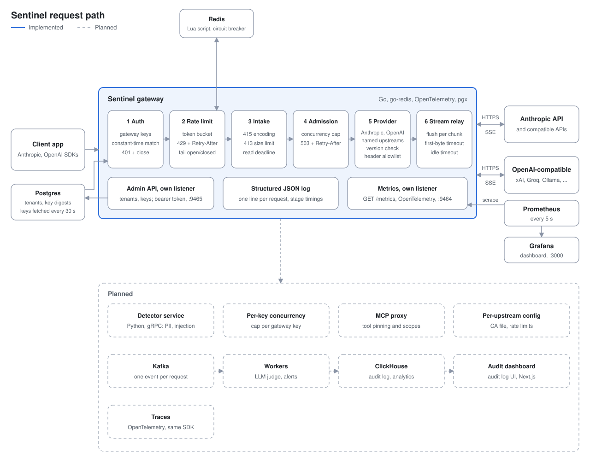
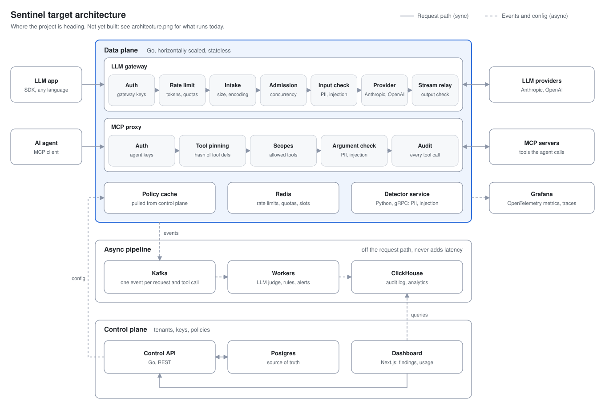

# Sentinel

**A security gateway for LLM applications and AI agents.**

Sentinel is a reverse proxy that sits between your application and an LLM provider. It speaks the Anthropic Messages API and the OpenAI Chat Completions API, so it fronts Anthropic, OpenAI, and any provider that speaks one of them, such as xAI, Groq or a local Ollama, several side by side, added by configuration alone. Clients point their existing SDK at Sentinel instead of the provider. Sentinel authenticates them, forwards the request with its own upstream credentials, relays the response (including streams) as it arrives, and records a structured log line with per-stage timings for every request.

The goal is a single control point for LLM traffic: who is calling, what is being sent, and what an agent is allowed to do. Detection of prompt injection and sensitive data, policy enforcement, and an audit trail are being built on top of this core.

[](https://github.com/shahardalva/sentinel/actions/workflows/ci.yml)




> **Status:** the gateway core in the solid box is implemented and tested. The components in the dashed box are on the roadmap. See [Roadmap](#roadmap).

---

## Contents

- [Why](#why)
- [What works today](#what-works-today)
- [Quick start](#quick-start)
- [Configuration](#configuration)
- [Request lifecycle](#request-lifecycle)
- [Error responses](#error-responses)
- [Logging](#logging)
- [Performance](#performance)
- [Design decisions](#design-decisions)
- [Project layout](#project-layout)
- [Testing](#testing)
- [Known limitations](#known-limitations)
- [Roadmap](#roadmap)
- [License](#license)

---

## Why

Teams are connecting LLMs and agents to internal data and tools faster than they are adding controls around them. Typical gaps:

- Provider API keys are shared across services and developers, with no per-client identity.
- Nothing inspects prompts for leaked secrets or personal data before they leave the network.
- Agents can call any tool exposed to them, and a changed tool description goes unnoticed.
- There is no reliable record of who sent what, and when.

Sentinel addresses these at the network layer, so applications don't need to change beyond their base URL and key.

## What works today

**Protocols**
- Anthropic Messages API on `POST /v1/messages`, and the OpenAI Chat Completions API on `POST /v1/chat/completions`. `SENTINEL_UPSTREAMS` picks which are served; a route exists only for an enabled upstream.
- Named upstreams: any OpenAI- or Anthropic-compatible provider (xAI, Groq, Ollama, vLLM, ...) is added with three environment variables and served on its own prefix, such as `POST /xai/v1/chat/completions`. Several of one protocol run side by side, each with its own key. See [Named upstreams](#named-upstreams).
- Every route shares the client keys, the rate limiter and one concurrency cap. Each answers the gateway's own errors in its protocol's shape.

**Security**
- Per-client gateway keys, accepted as `x-api-key` or `Authorization: Bearer`. Keys are compared as SHA-256 digests in constant time.
- The upstream provider key never leaves the gateway. Client credential headers are stripped before the request is forwarded.
- The gateway never follows an upstream redirect. On a redirect to another host Go's HTTP client keeps every header except `Authorization`, so following one would hand the gateway's `x-api-key` to whatever host the upstream named. A redirect is answered with `502` and logged as `upstream redirect refused`.
- On the OpenAI route no client header is forwarded at all. `OpenAI-Organization` and `OpenAI-Project` choose who is billed, so a client never gets to set them; `OpenAI-Beta` and the SDKs' `X-Stainless-*` headers are dropped too.
- Upstream response headers pass through an allowlist. Organization and project IDs, cookies and CDN headers are dropped.
- Per-key rate limiting in Redis: a token bucket per client key, answered with `429` and `Retry-After` before the body is read. Redis stores only a SHA-256 digest of each key.
- Early rejections (400 for an unclean path, 401, 413, 415, 429, 503, 404/405) close the connection with a bounded read deadline, so a client can't hold a connection open by stalling mid-body.
- `anthropic-version` must be a real `YYYY-MM-DD` date. `anthropic-beta` values with control characters are rejected.
- The upstream base URL must be `https` (plain `http` is allowed only for loopback test servers). The gateway refuses to start otherwise.
- Binds to `127.0.0.1` by default. Exposing it on a network is an explicit choice.

**Streaming and timeouts**
- Server-sent events are flushed to the client after every chunk, so tokens arrive as they are generated.
- Separate limits for time to first byte, idle time between chunks, and client write time. A long stream that keeps producing data completes. A stalled one is aborted.
- Graceful shutdown with a 30-second grace period for in-flight requests and streams.

**Resource limits**
- A concurrency cap on requests in flight upstream, returning `503` with `Retry-After` when full.
- The request body is read before a slot is taken, so slow uploads don't hold capacity.
- A declared `Content-Length` over the limit is rejected before any bytes are read. The initial buffer is capped, so a large declared length doesn't reserve memory up front.
- A pooled upstream connection, so requests under load reuse TLS connections.

**Observability**
- One JSON log line per request with the gateway's `request_id`, the provider's `upstream_request_id`, and timings for each stage.
- On failure, the log records the phase where it happened and the cause. Client-side problems log at `WARN`, server and upstream problems at `ERROR`.
- Every response carries an `X-Request-Id` header that matches the log line.

**Engineering**
- One third-party dependency, `go-redis`, for rate limiting ([ADR 0002](docs/adr/0002-rate-limiting.md)). Everything else is the standard library.
- Provider-agnostic core. The handler knows nothing about Anthropic or OpenAI; provider-specific behavior lives behind a `Provider` interface. Adding the OpenAI provider changed no file in the core.
- Tests cover the behavior above and pass under the race detector. Rate-limit tests run against an in-process Redis (`miniredis`), so CI needs no Redis server.

## Quick start

### Requirements

- Go 1.27 or later
- An Anthropic API key, an OpenAI API key, or a local OpenAI-compatible server such as Ollama (none needed for the mock upstream)
- For the Docker setup: Docker with Compose v2.24 or later, and `make`

### Run with Docker Compose

The compose stack runs the gateway, a mock upstream over HTTPS and Redis, which the gateway uses for rate limiting. The gateway is published on `127.0.0.1:8081` only.

```bash
cp .env.example .env   # then fill it in; .env is gitignored
openssl rand -hex 32   # a client key of your own; put it in SENTINEL_API_KEYS
make up                # gateway -> mockupstream over HTTPS
make logs
make down
```

`.env.example` ships with empty keys. Choose your own client key for `SENTINEL_API_KEYS` (the gateway refuses to start without one), and set `ANTHROPIC_API_KEY` or `OPENAI_API_KEY` only if you will run `make up-real`. Clients then send that key as `x-api-key` or `Authorization: Bearer`.

`make up` serves both protocols, with both upstreams pointed at the mock (`https://mockupstream:9090` and `https://mockupstream:9090/v1`), and trusts the dev CA from `./certs`. It first runs `make certs`, which writes the certificates (valid for 30 days) when they are missing or expire within 7 days, and recreates the containers so they load the current ones. It replaces `ANTHROPIC_API_KEY` and `OPENAI_API_KEY` with dummies, so your real keys never reach the mock. `make up-real` starts the gateway against the real APIs with the keys from `.env`; it serves the upstreams in `SENTINEL_UPSTREAMS` from `.env`, Anthropic only by default.

The images are built from the `Dockerfile` on a distroless base and run as a non-root user. Without `make`:

```bash
docker compose -f docker-compose.yml -f docker-compose.mock.yml --profile mock up -d --build   # mock
docker compose up -d --build                                                                  # real
```

`make up` also enables a custom upstream, `mockcompat`, on the mock's OpenAI API, so the prefixed route `POST /mockcompat/v1/chat/completions` works out of the box.

Run `make` to list the targets with a line on each. `make bench-gateway` load-tests a separate `gateway-bench` service that is fixed to the mock upstream and holds no real key. It reads the base URLs that gateway logs at startup and refuses to run unless every one is the mock's, so a load test never reaches a real API.

### Run the gateway

```bash
git clone https://github.com/shahardalva/sentinel.git
cd sentinel

export ANTHROPIC_API_KEY="sk-ant-..."             # the gateway's upstream key
export SENTINEL_API_KEYS="$(openssl rand -hex 32)"  # a client key you choose

go run ./cmd/gateway
```

The gateway logs a `listening` line and serves on `127.0.0.1:8081`.

### Send a request

```bash
curl http://127.0.0.1:8081/v1/messages \
  -H "x-api-key: $SENTINEL_API_KEYS" \
  -H "content-type: application/json" \
  -H "anthropic-version: 2023-06-01" \
  -d '{
    "model": "claude-haiku-5-5",
    "max_tokens": 64,
    "messages": [{"role": "user", "content": "Say hello in five words."}]
  }'
```

The client sends its **gateway key**. The real Anthropic key stays inside the gateway.

### Stream a response

Add `"stream": true` to the body and `-N` to curl, so events print as they arrive:

```bash
curl -N http://127.0.0.1:8081/v1/messages \
  -H "x-api-key: $SENTINEL_API_KEYS" \
  -H "content-type: application/json" \
  -d '{"model":"claude-haiku-5-5","max_tokens":64,"stream":true,
       "messages":[{"role":"user","content":"Count from 1 to 10."}]}'
```

### Use it from an SDK

Point the official SDK at the gateway and pass the gateway key:

```python
from anthropic import Anthropic

client = Anthropic(base_url="http://127.0.0.1:8081", api_key="<your client key>")
message = client.messages.create(
    model="claude-haiku-5-5",
    max_tokens=64,
    messages=[{"role": "user", "content": "Hello"}],
)
print(message.content[0].text)
```

### Use it with the OpenAI SDK

Start the gateway with the openai upstream enabled (alone, or next to Anthropic with `SENTINEL_UPSTREAMS=anthropic,openai`):

```bash
export SENTINEL_UPSTREAMS=openai
export OPENAI_API_KEY="sk-..."                      # the gateway's upstream key
export SENTINEL_API_KEYS="$(openssl rand -hex 32)"  # a client key you choose
go run ./cmd/gateway
```

Then point the OpenAI SDK at the gateway. The base URL includes `/v1`, as the SDK expects:

```python
from openai import OpenAI

client = OpenAI(base_url="http://127.0.0.1:8081/v1", api_key="<your client key>")
completion = client.chat.completions.create(
    model="gpt-4o-mini",
    messages=[{"role": "user", "content": "Hello"}],
)
print(completion.choices[0].message.content)
```

The SDK sends the client key as `Authorization: Bearer`. The gateway swaps it for its own `OPENAI_API_KEY`. `stream=True` works the same way.

### Use a named upstream

Any other provider that speaks one of the two protocols is a named upstream: list a name in `SENTINEL_UPSTREAMS` and give it a protocol, a base URL and a key. Here xAI runs next to OpenAI:

```bash
export SENTINEL_UPSTREAMS=openai,xai
export OPENAI_API_KEY="sk-..."
export SENTINEL_UPSTREAM_XAI_PROTOCOL=openai
export SENTINEL_UPSTREAM_XAI_BASE_URL=https://api.x.ai/v1
export SENTINEL_UPSTREAM_XAI_API_KEY="xai-..."
export SENTINEL_API_KEYS="$(openssl rand -hex 32)"
go run ./cmd/gateway
```

A client picks the upstream with the prefix in its base URL. The client key is the same for every upstream:

```python
from openai import OpenAI

xai = OpenAI(base_url="http://127.0.0.1:8081/xai/v1", api_key="<your client key>")
openai = OpenAI(base_url="http://127.0.0.1:8081/v1", api_key="<your client key>")  # the built-in openai upstream
```

An upstream with protocol `anthropic` works the same way with the Anthropic SDK, whose base URL has no `/v1`: `Anthropic(base_url="http://127.0.0.1:8081/<name>")`.

### Use a local model with Ollama

Run the gateway on the host, next to Ollama, and add Ollama's OpenAI-compatible API as a named upstream. Plain `http` is allowed because the host is loopback. Ollama ignores the upstream key, but the gateway requires one:

```bash
SENTINEL_UPSTREAMS=ollama \
SENTINEL_UPSTREAM_OLLAMA_PROTOCOL=openai \
SENTINEL_UPSTREAM_OLLAMA_BASE_URL=http://127.0.0.1:11434/v1 \
SENTINEL_UPSTREAM_OLLAMA_API_KEY=ollama \
SENTINEL_API_KEYS="$(openssl rand -hex 32)" \
go run ./cmd/gateway
```

Clients then use the OpenAI SDK with `base_url="http://127.0.0.1:8081/ollama/v1"` and a model Ollama has pulled, such as `model="llama3.2"`. Add `openai` or `anthropic` to the list to serve them next to it. Inside the compose stack the gateway can't reach the host's loopback, and plain `http` is refused for any other host, so this recipe is for a gateway on the host.

## Configuration

All configuration comes from environment variables. Secrets are never read from files in the repository.

| Variable | Required | Default | Description |
| --- | --- | --- | --- |
| `SENTINEL_UPSTREAMS` | No | `anthropic` | Comma-separated upstreams to serve: the built-in `anthropic` (`POST /v1/messages`) and `openai` (`POST /v1/chat/completions`), and any [named upstreams](#named-upstreams). A name that breaks the naming rule, a duplicate, or a list with no names stops startup. The gateway logs one line per enabled upstream with its name, protocol and base URL, as `scheme://host[:port]` only, since a path may hold a token. |
| `ANTHROPIC_API_KEY` | When `anthropic` is listed | | The gateway's own key for the Anthropic API. Clients never see it. |
| `OPENAI_API_KEY` | When `openai` is listed | | The gateway's own key for the OpenAI-compatible API. Clients never see it. |
| `SENTINEL_API_KEYS` | Yes | | Comma-separated client keys, shared by every route. The gateway refuses to start without at least one. |
| `SENTINEL_ADDR` | No | `127.0.0.1:8081` | Listen address. Loopback only by default. |
| `ANTHROPIC_BASE_URL` | No | `https://api.anthropic.com` | Anthropic upstream override. Must be `https`, except for a loopback host. |
| `OPENAI_BASE_URL` | No | `https://api.openai.com/v1` | OpenAI-compatible upstream, including `/v1` as in the OpenAI SDKs' own variable; the gateway appends `/chat/completions`. Must be `https`, except for a loopback host. |
| `SENTINEL_MAX_CONCURRENT` | No | `128` | Cap on requests in flight upstream, across all routes. Must be a positive integer. See [ADR 0001](docs/adr/0001-concurrency-cap.md). |
| `SENTINEL_UPSTREAM_CA_FILE` | No | | PEM file of extra CA certificates to trust for the upstream connections, added to the system trust store. For a private or dev CA (see `cmd/devcerts`). Applies to every enabled upstream. Every PEM block must be a valid certificate; the gateway refuses to start if the file is missing, holds none, or holds anything else. The CAs are trusted for whatever hosts the base URLs name, including the defaults; the gateway logs a warning for each enabled upstream left on its public default (`api.anthropic.com`, `api.openai.com`), since anyone holding the CA's key could then impersonate that API. Does not relax the `https` rule. |
| `SENTINEL_REDIS_URL` | No | | Redis for per-key rate limiting, as `redis://[:password@]host:port/db` or `rediss://` for TLS. Unset turns rate limiting off, and the gateway logs that at startup. A malformed URL stops startup. An unreachable Redis at startup is only a warning. |
| `SENTINEL_RATE_LIMIT_RPM` | No | `60` | Requests per minute per client key. Also the burst: a full bucket holds a minute's worth. Must be a positive integer. |
| `SENTINEL_RATE_LIMIT_FAIL_MODE` | No | `open` | What happens when Redis can't answer within 50 ms. `open` lets the request through and logs a `WARN`, at most once per 10 seconds. `closed` answers `503`. After 5 failures in a row, a circuit breaker skips Redis for 5 seconds and applies the fail mode at once, then lets one request try Redis again. See [ADR 0002](docs/adr/0002-rate-limiting.md). |

An upstream key that is set while its upstream is not listed, such as `OPENAI_API_KEY` with the default list, is not used; the gateway logs a `WARN` saying so at startup.

With Docker Compose, the gateway reads these from `.env` (copy `.env.example`; `.env` is gitignored), named upstreams' variables included. Compose sets `SENTINEL_ADDR=0.0.0.0:8081` inside the container and publishes the port on `127.0.0.1` only. `make up` also sets `SENTINEL_UPSTREAMS=anthropic,openai,mockcompat`, `ANTHROPIC_BASE_URL=https://mockupstream:9090`, `OPENAI_BASE_URL=https://mockupstream:9090/v1`, the `mockcompat` upstream (protocol `openai`, base URL `https://mockupstream:9090/v1`), `SENTINEL_UPSTREAM_CA_FILE=/certs/ca.pem` and dummy upstream keys. Named upstreams in `.env` are then unlisted, so they are not used. The gateway and k6 mount only `certs/ca.pem`; the server key goes only to mockupstream. Compose also points the gateway at its Redis with `SENTINEL_REDIS_URL=redis://redis:6379/0`. `BENCH_API_KEY` in `.env` (optional, default `bench`) is the only key the `gateway-bench` service accepts and the one `make bench-gateway` sends. `gateway-bench` serves the same three upstreams from the mock, and `make bench-gateway` refuses to run unless every base URL it logs at startup is the mock's. It rate limits through Redis database 1 with a limit of 1,000,000 a minute, so load tests include the Redis call but never get a `429`.

Built-in limits:

| Limit | Value | Purpose |
| --- | --- | --- |
| Max request body | 32 MiB | Matches the provider's request size limit |
| Concurrent upstream requests | 128 (`SENTINEL_MAX_CONCURRENT`) | Bounds memory and upstream connections |
| Rate limit | 60 requests/min per key (`SENTINEL_RATE_LIMIT_RPM`) | Stops one key from using the whole budget. Off without `SENTINEL_REDIS_URL` |
| Redis call timeout | 50 ms | A slow Redis adds at most this much to a request |
| Body read timeout | 2 min | Bounds slow uploads |
| Time to first byte | 10 min | Non-streaming requests send nothing until generation finishes |
| Stream idle timeout | 60 s | Aborts a stream that stops producing data |
| Header read timeout | 10 s | Bounds slow request headers |
| Auth read timeout | 5 s | Bounds reads while a request is unauthenticated |
| Shutdown grace period | 30 s | Lets in-flight streams finish |

### Named upstreams

Any provider that speaks the Anthropic or OpenAI protocol is added by listing a name in `SENTINEL_UPSTREAMS` and setting three variables, with the name upper-cased:

| Variable | Description |
| --- | --- |
| `SENTINEL_UPSTREAM_<NAME>_PROTOCOL` | `anthropic` or `openai`. |
| `SENTINEL_UPSTREAM_<NAME>_BASE_URL` | The provider's base URL. For `openai` it includes `/v1`, as in the OpenAI SDKs, and the gateway appends `/chat/completions`; for `anthropic` the gateway appends `/v1/messages`. Same `https` rule as the built-ins. |
| `SENTINEL_UPSTREAM_<NAME>_API_KEY` | The gateway's own key for that provider. Clients never see it. |

All three are required; there is no default base URL. Startup fails, naming the variable, if one is missing or invalid, and the error never contains a URL or a key. Each named upstream is served on `POST /<name>/v1/chat/completions` or `POST /<name>/v1/messages`, by its protocol, so a client sets its SDK's base URL to `http://<gateway>/<name>/v1` (OpenAI SDKs) or `http://<gateway>/<name>` (Anthropic SDKs). The unprefixed routes belong to the built-in `anthropic` and `openai`, which are also served on `/anthropic/...` and `/openai/...`. An unknown prefix gets a `404`.

```bash
SENTINEL_UPSTREAMS=anthropic,xai,groq,ollama

# xAI
SENTINEL_UPSTREAM_XAI_PROTOCOL=openai
SENTINEL_UPSTREAM_XAI_BASE_URL=https://api.x.ai/v1
SENTINEL_UPSTREAM_XAI_API_KEY=xai-...

# Groq
SENTINEL_UPSTREAM_GROQ_PROTOCOL=openai
SENTINEL_UPSTREAM_GROQ_BASE_URL=https://api.groq.com/openai/v1
SENTINEL_UPSTREAM_GROQ_API_KEY=gsk_...

# Ollama on the gateway's host; it ignores the key, but one is required
SENTINEL_UPSTREAM_OLLAMA_PROTOCOL=openai
SENTINEL_UPSTREAM_OLLAMA_BASE_URL=http://127.0.0.1:11434/v1
SENTINEL_UPSTREAM_OLLAMA_API_KEY=ollama
```

Rules:

- A name is a lowercase letter followed by up to 31 lowercase letters or digits: `^[a-z][a-z0-9]{0,31}$`. No hyphens or underscores, so each variable maps back to one name. `v1` and `ca` are reserved (`ca` would collide with `SENTINEL_UPSTREAM_CA_FILE`).
- `anthropic` and `openai` keep their own variables (`ANTHROPIC_*`, `OPENAI_*`). Setting any `SENTINEL_UPSTREAM_ANTHROPIC_*` or `SENTINEL_UPSTREAM_OPENAI_*` variable stops startup. Variable names are matched ignoring case, as Windows does.
- Only listed upstreams are used. `SENTINEL_UPSTREAM_<NAME>_*` variables for a name not in the list are neither validated nor used, and the gateway logs one `WARN` per such name, without the values. A listed upstream's variables with any other suffix, such as `SENTINEL_UPSTREAM_XAI_APIKEY`, get one `WARN` per upstream, too.
- Every upstream shares the client keys, the rate limit and the concurrency cap. `SENTINEL_UPSTREAM_CA_FILE` applies to all of them.

The design is in [ADR 0003](docs/adr/0003-named-upstreams.md).

## Request lifecycle

Each request moves through six stages. Every stage can end the request, and each one is timed.

1. **Auth.** Match the client key in constant time. Strip credential headers.
2. **Rate limit.** Take a token from the key's bucket in Redis, or answer `429`. Runs before the body is read, so a rejected request costs one Redis call and no upload.
3. **Intake.** Reject compressed bodies and oversized declared lengths, then read the body under a deadline.
4. **Admission.** Take a concurrency slot, or shed load with `503`.
5. **Provider.** Validate provider headers, attach the gateway's credentials, forward, and filter the response headers.
6. **Stream relay.** Copy the response to the client, flushing every chunk, with idle and write deadlines.

The logged timings map to these stages: `rate_limit_us` for the Redis call, `read_body_ms` for intake, `upstream_ttfb_ms` until the provider's response headers arrive, and `stream_ms` for the relay.

## Error responses

The shape of an error the gateway itself answers with follows the route's protocol, so each SDK parses it unchanged. On `/v1/messages` it is the Anthropic API's shape:

```json
{"type": "error", "error": {"type": "authentication_error", "message": "invalid x-api-key"}}
```

On `/v1/chat/completions` it is the OpenAI API's shape:

```json
{"error": {"message": "invalid x-api-key", "type": "invalid_request_error", "param": null, "code": "invalid_api_key"}}
```

| Status | Anthropic `error.type` | OpenAI `error.type` / `error.code` | When |
| --- | --- | --- | --- |
| 400 | `invalid_request_error` | `invalid_request_error` / `null` | Body can't be read, or a provider header is invalid |
| 400 | plain text | plain text | The path isn't already clean: a double slash, a `.` or `..` segment, or a trailing slash (`//v1/messages`, `/xai/./v1/chat/completions`). Answered before routing, with `Connection: close`, never with a redirect to the cleaned path |
| 401 | `authentication_error` | `invalid_request_error` / `invalid_api_key` | Missing or unknown gateway key |
| 408 | `timeout_error` | `timeout_error` / `null` | Request body not received in time |
| 413 | `request_too_large` | `invalid_request_error` / `request_too_large` | Body larger than the limit, declared or actual |
| 415 | `invalid_request_error` | `invalid_request_error` / `null` | Request has a `Content-Encoding` |
| 429 | `rate_limit_error` | `requests` / `rate_limit_exceeded` | The client key is over its rate limit. `Retry-After` says when a token is back |
| 502 | `api_error` | `server_error` / `null` | Provider unreachable, it rejected the gateway's own credentials, or it answered with a redirect |
| 503 | `overloaded_error` | `server_error` / `overloaded` | Gateway at capacity. Includes `Retry-After` |
| 503 | `api_error` | `server_error` / `null` | Redis unavailable with `SENTINEL_RATE_LIMIT_FAIL_MODE=closed`. Includes `Retry-After` |
| 504 | `timeout_error` | `timeout_error` / `null` | Provider didn't respond in time |

OpenAI SDKs pick their exception class from the HTTP status (`RateLimitError` for a `429`, for example), so the OpenAI type and code strings are informative. They follow OpenAI's documented error shape, but not every value has been checked against OpenAI's live responses.

A provider `401` or `403` is reported as `502 upstream authentication failed`, not passed through. Clients never authenticate to the provider, so passing it on would make a revoked gateway key look like a problem with the client's key.

If the client disconnects, the upstream request is cancelled and the log records status `499`. A stream that fails after the `200` has been sent can't change its status; the failure is logged at `ERROR` with `phase: stream`.

## Logging

Logs are JSON on stdout, one line per request:

```json
{
  "time": "2026-10-08T15:46:36.87+03:00",
  "level": "INFO",
  "msg": "request",
  "request_id": "JM4FWMO5DFDCXTXC6U6SFNSX6Z",
  "upstream": "anthropic",
  "provider": "anthropic",
  "model": "claude-haiku-5-5",
  "status": 200,
  "latency_ms": 974,
  "rate_limit_us": 412,
  "rate_limit_remaining": 59,
  "read_body_ms": 0,
  "upstream_ttfb_ms": 973,
  "stream_ms": 0,
  "upstream_request_id": "req_011Cfpo4jdYgqjq6yWBZDFEx"
}
```

- `request_id` matches the `X-Request-Id` response header, so a client report can be traced to its log line.
- `upstream` is the name of the upstream the request went to (`anthropic`, `openai`, or a [named upstream](#named-upstreams) such as `xai`), and `provider` is its protocol. A request to `/xai/v1/chat/completions` logs `"upstream": "xai", "provider": "openai"`.
- `upstream_request_id` is the provider's ID for the same request, for support cases with the provider.
- `latency_ms` minus `read_body_ms`, `upstream_ttfb_ms` and `stream_ms` is the time the gateway itself added. In this example it is about 1 ms. That is a single local request, not a benchmark; see [Performance](#performance) for load-test numbers.
- With rate limiting on, `rate_limit_us` is how long the Redis call took, and `rate_limit_remaining` how many requests the key has left right now. `rate_limit_remaining` is missing when Redis couldn't answer.
- Failed requests add `error` and `phase` (`rate_limit`, `read_body`, `admit`, `upstream` or `stream`). An upstream `error` names the cause without the request URL, such as `openai: forward: Post: dial tcp 10.0.0.5:443: connect: connection refused`, since a base URL's path may hold a token.

## Performance

Load tests against a mock upstream measure the time the gateway itself adds to each request.

- Median gateway overhead is about 1 ms or less at every tested rate up to 1000 req/s.
- p99 spikes moved between runs, which points at the shared test machine rather than a fixed cost in the gateway.
- In one of two runs at 1000 req/s, the concurrency cap shed 0.22% of requests with `503`.

Full numbers are in [bench/RESULTS.md](bench/RESULTS.md). To reproduce them, see [bench/README.md](bench/README.md).

## Design decisions

**Standard library first.** `net/http` covers routing, streaming and per-request deadlines. Fewer dependencies mean a smaller attack surface for a security component. The one exception is `go-redis` for rate limiting, since a Redis client is not something to hand-roll; see [ADR 0002](docs/adr/0002-rate-limiting.md).

**Fail open on a Redis outage, by default.** If Redis can't answer within 50 ms, the request goes through and the gateway logs a warning. An outage then loses rate limiting rather than all traffic. `SENTINEL_RATE_LIMIT_FAIL_MODE=closed` reverses that choice.

**A provider-agnostic core.** The handler talks to a `Provider` interface that returns a small `Response` struct. Header filtering, request IDs and version validation live in the providers. The OpenAI provider was added on these seams without changing a file in `internal/proxy`. Three seams keep the core free of any one protocol, so a second protocol or upstream adds code beside it rather than inside it:

- **Shared admission.** The concurrency cap is a `proxy.Admission` created once in `cmd/gateway` and handed to every handler. Each new route or upstream draws on the same slots, so the memory bound in [ADR 0001](docs/adr/0001-concurrency-cap.md) stays one bound rather than one per route.
- **Protocol-owned errors.** The core knows error kinds (invalid request, authentication, rate limit, too large, timeout, overloaded, upstream failure), not error shapes. Every error the gateway itself answers with, including the `401` from `RequireKey`, is rendered by the route's `ErrorFormatter`, so clients of each protocol get errors their SDK can parse. The Anthropic provider maps the kinds to Anthropic's error types.
- **Shared upstream plumbing.** `internal/provider/upstream` holds the security-critical parts every provider needs: the https-only rule with its loopback exception, the pooled HTTP client with a TLS 1.2 floor and extra CAs added to the system pool, and the header control-character check. A new provider calls it instead of copying it.

**Upstreams are named and routed by prefix.** A protocol (Anthropic or OpenAI) is code; an upstream is configuration: a name, a protocol, a base URL and a key. A client picks the upstream with the path prefix in its SDK's base URL, not by the `model` field, which is client-controlled and would need a model table kept current across providers. Custom upstreams have no defaults, so a key meant for one provider can't end up at another's public API. See [ADR 0003](docs/adr/0003-named-upstreams.md).

**Per-chunk deadlines instead of a request deadline.** A single deadline for the whole request would cut off long, healthy streams. Sentinel bounds the time to first byte, the idle time between chunks, and each write to the client instead. The server has no global `ReadTimeout` or `WriteTimeout` for the same reason.

**Read the body before taking a slot.** Otherwise one client could fill every slot with slow uploads and lock everyone else out. Admission happens only once the body is fully in memory.

**Shed load rather than queue.** A queued request still holds a connection and its memory, so queuing only moves the pressure. A fast `503` with `Retry-After` lets clients back off.

**Close the connection on early rejects.** Go's server drains up to 256 KiB of an unread body, with no deadline, before it sends a response. With no global read timeout, a client could send headers, stall, and never receive its `401`. Rejections set `Connection: close` and a short read deadline. A test reproduces the stall over a raw TCP connection.

**Distinguish client errors from upstream errors.** A provider can reject a request with a `RequestError`, which becomes a `400`. Everything else from upstream is a `502` or `504`. The status code tells the client whose problem it is.

## Project layout

```
sentinel/
├── cmd/gateway/              # entry point: config, server, graceful shutdown
├── cmd/mockupstream/         # fake Messages and Chat Completions APIs for load tests, http or https
├── cmd/devcerts/             # writes a dev CA and server certificate to ./certs
├── cmd/benchguard/           # make bench-gateway's check that every upstream gateway-bench resolved is the mock
├── internal/devcert/         # certificate generation used by devcerts and tests
├── internal/ratelimit/       # per-key rate limiting
│   ├── ratelimit.go          #   token bucket as an atomic Redis Lua script
│   └── breaker.go            #   circuit breaker around Redis
├── internal/proxy/           # provider-agnostic core
│   ├── admission.go          #   concurrency cap shared by all routes
│   ├── auth.go               #   gateway key authentication
│   ├── errors.go             #   error kinds and the ErrorFormatter seam
│   └── handler.go            #   rate limit, intake, admission, forwarding, stream relay, logging
├── internal/provider/
│   ├── anthropic/            # Anthropic Messages API provider and its error shape
│   ├── openai/               # OpenAI-compatible Chat Completions provider and its error shape
│   └── upstream/             # shared upstream plumbing: base URL rule, TLS client, header checks
├── bench/                    # k6 load test and results
├── docs/
│   ├── adr/                  # architecture decision records
│   ├── notes.md              # dev log: what was done, decided, learned, next
│   └── *.svg, *.png          # current and target architecture diagrams
├── .github/workflows/ci.yml  # gofmt, vet, race tests with real Redis, docker build
├── Dockerfile                # gateway and mockupstream images
├── docker-compose.yml        # local stack with Redis; real upstream by default
├── docker-compose.mock.yml   # override: gateway -> mockupstream over HTTPS
├── Makefile                  # dev tasks
├── .env.example              # required environment variables, no secrets
├── CLAUDE.md                 # conventions and git workflow for Claude Code
├── go.mod
├── LICENSE
└── NOTICE
```

## Testing

```bash
go test -race ./...
go vet ./...
```

The race detector needs cgo and a C compiler. On Windows, install `gcc` through MSYS2 (`mingw-w64-ucrt-x86_64-gcc`) and add it to `PATH`.

The tests exercise behavior end to end against fake upstream servers, including:

- authentication with missing, wrong and valid keys, and credentials never reaching the upstream or the logs
- a client that sends a partial body without a key, over a raw connection
- streamed events arriving before the stream ends
- a slow first byte, a long active stream, and a stalled stream
- a mid-stream upstream failure and a client disconnect mid-stream
- oversized bodies, declared and actual, and a slow body that must not hold a slot
- the concurrency cap returning `503`
- rate limiting: under and over the limit with the right `Retry-After`, refill over time, separate buckets per key, only a hash of the key in Redis, a `429` before the body is read, Redis down in fail-open and fail-closed mode, a stalled Redis cut off by the timeout, and the circuit breaker opening, probing and closing
- the upstream rejecting the gateway's key
- response header filtering and `anthropic-version` validation
- the OpenAI route end to end: only the gateway's bearer key and `Content-Type` reach the upstream, never a client's `OpenAI-Organization`, `OpenAI-Project`, `OpenAI-Beta` or `X-Stainless-*`; streamed chunks and `data: [DONE]` arriving as sent; and the exact OpenAI-shaped bodies of the gateway's `401`, `429`, `502` and `503`
- `SENTINEL_UPSTREAMS` parsing, a route existing only for an enabled upstream, and one shared concurrency cap: a request held on `/v1/messages` makes `/v1/chat/completions` answer `503`
- named upstreams: the naming rule, missing or invalid protocol, base URL and key, `SENTINEL_UPSTREAM_OPENAI_*` rejected, unlisted upstreams warned about and not used, and no key or URL secret in any error or log line; two upstreams of one protocol, each on its own test server with its own key, where each prefix reaches only its server and neither key reaches the other; unprefixed routes only for the built-ins, `404` with `Connection: close` for an unknown prefix, and one concurrency cap across prefixes
- the `upstream` and `provider` fields of the request log
- the bench guard: anything but exactly `https://mockupstream:9090` (a path, another port, a look-alike host) is refused, as are duplicate or differently-cased `base_url` keys and unreadable lines
- refused upstream redirects (both protocols: the redirect target never sees a request) and unclean paths answered `400` over a raw connection instead of hanging
- an upstream signed by a CA from `SENTINEL_UPSTREAM_CA_FILE` accepted, one from an unknown CA rejected, and a bad CA file stopping startup

## Known limitations

- Only `POST /v1/messages` is proxied on the Anthropic side. Other Anthropic endpoints return `404`.
- Only `POST /v1/chat/completions` is proxied on the OpenAI side. The Responses API, embeddings, models and other endpoints return `404`.
- One CA file for all upstreams: `SENTINEL_UPSTREAM_CA_FILE` is trusted for every enabled upstream, so a private CA added for a local server is trusted for the public providers too. The gateway warns for every enabled upstream, built-in or custom, on a public default host (`api.anthropic.com`, `api.openai.com`). Tracked as an issue.
- Upstreams are picked by path prefix only. There is no routing by model and no fallback between upstreams, and the rate limit is per client key, not per upstream.
- The `401` message says `invalid x-api-key` on both routes, even when the client sent its key as `Authorization: Bearer`.
- Azure OpenAI, Amazon Bedrock and Google Vertex AI need their own authentication schemes and are not supported.
- Upstream error bodies are passed through as-is, so they may name the gateway's upstream account (its organization or project IDs), even though those response headers are dropped. Tracked as an issue.
- Request body fields that choose billing or retention, such as OpenAI's `service_tier` and `store`, reach the upstream unchanged until the policy stage lands.
- `X-Ratelimit-*` response headers show the shared upstream account's quota, not the client's own, until per-key limits exist.
- Tools whose vendor routes model traffic through its own servers (Cursor, for example) can't be pointed at a gateway on loopback, and only the parts of a tool that honor a custom base URL pass through the gateway at all.
- Rate limits are per request, not per token, and every key gets the same limit. Without `SENTINEL_REDIS_URL` there is no limit, and one valid key can use the whole concurrency budget.
- `anthropic-beta` values are forwarded without an allowlist. Restricting beta features belongs to the planned policy stage.
- The logged `model` field is best effort: it comes from a separate JSON parse and is not authoritative.
- Query strings are not forwarded upstream.
- Streaming has not been load-tested yet.

The ones marked "Tracked as an issue" have a fix planned; the rest are deliberate scope limits for now.

## Roadmap

### Target architecture

Where the project is heading. Not yet built; the diagram at the top of this README shows what runs today.



| Phase | Scope |
| --- | --- |
| **1. Core proxy** | Anthropic provider, auth, streaming, timeouts, resource limits, structured logging. **Done.** |
| **2. Platform** | Docker Compose with Postgres and Redis, CI, per-key rate limits, OpenAI provider (**done**: OpenAI-compatible Chat Completions), named upstreams (**done**: any OpenAI- or Anthropic-compatible provider by configuration; per-upstream CA and limits next), k6 load tests with published p50/p99 overhead |
| **3. Detection** | Secret detection in the gateway, a Python detector service over gRPC for PII and prompt injection, a public evaluation set with precision and recall |
| **4. Agents** | MCP proxy with tool pinning, tool allowlists and scopes per tenant |
| **5. Audit pipeline** | Kafka event stream, workers for LLM-as-judge and alerts, ClickHouse audit log with a hash chain, dashboard |
| **6. Deployment** | Helm chart, Kubernetes with autoscaling and zero-downtime rollouts, AWS with Terraform |

## License

Copyright 2026 Shahar Dalva. Licensed under the [Apache License 2.0](LICENSE); see [NOTICE](NOTICE).
